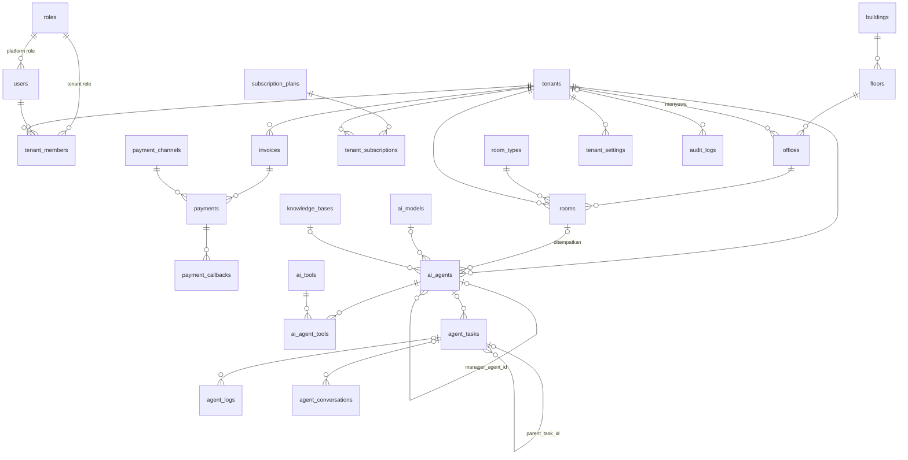

# Skema Database — Virtual AI Office

26 tabel, MySQL 8 / MariaDB 10.6+ (InnoDB, utf8mb4). Migrasi juga berjalan di SQLite
untuk test. Semua uang disimpan sebagai **BIGINT Rupiah utuh** (Tripay memakai integer IDR).
Kolom JSON memakai tipe `JSON` di MySQL dan `TEXT` di SQLite.

```bash
php spark migrate
php spark db:seed DatabaseSeeder   # CoreSeeder (+ DemoSeeder jika bukan production)
```

## ERD ringkas



## Tabel per domain

### Identitas (`000001`)
| Tabel | Kunci & constraint penting |
|---|---|
| `roles` | `slug` unik, `scope` platform/tenant, `permissions` JSON |
| `users` | `email` unik, FK `role_id`, soft delete, `last_login_at/ip` |
| `tenants` | `uuid` & `slug` unik, `status` (pending/active/suspended/expired), `is_listed` (tampil di directory gedung), soft delete |
| `tenant_members` | unik `(tenant_id, user_id)`, FK ke tenants/users/roles |

### Gedung (`000002`)
| Tabel | Catatan |
|---|---|
| `buildings` | `code` unik, `theme` JSON untuk warna scene 3D |
| `floors` | unik `(building_id, floor_number)`, `floor_type` lobby/office, `base_monthly_price` |
| `room_types` | katalog 10 ruangan (4 umum + 6 operasional), `layout` JSON posisi default di floor plate |
| `offices` | unit sewa; `office_number` unik; `tenant_id` NULL = kosong |
| `rooms` | milik tenant; `position` JSON `{x,z,w,d}`; `is_enabled` dibatasi paket |

### Langganan (`000003`)
| Tabel | Catatan |
|---|---|
| `subscription_plans` | semua harga/limit diubah Super Admin: `max_agents`, `max_operational_rooms`, `monthly_token_quota`, `allowed_room_types`, `features`, `is_custom` (Enterprise) |
| `tenant_subscriptions` | `status` pending/trial/active/past_due/expired/cancelled, `starts_at/ends_at`, **`price_snapshot` & `limits_snapshot`** agar perubahan paket tidak mengubah kontrak berjalan |

### Billing (`000004`)
| Tabel | Catatan |
|---|---|
| `payment_channels` | sinkron dari Tripay; unik `(provider, code)` |
| `invoices` | `invoice_number` unik, `status` unpaid/paid/expired/failed/refunded/cancelled |
| `payments` | satu baris per upaya bayar; `merchant_ref` unik, unik `(provider, provider_reference)`; `refund_status`; `is_sandbox`; payload request/response |
| `payment_callbacks` | log mentah append-only setiap webhook; **`event_hash` unik** → idempotensi; `signature_valid`, `process_status` |

### AI (`000005`)
| Tabel | Catatan |
|---|---|
| `ai_models` | katalog model per provider, harga per MTok diisi Super Admin |
| `ai_tools` | `tenant_id` NULL = tool platform; unik `(tenant_id, slug)` |
| `knowledge_bases` | per tenant, `status` indexing |
| `ai_agents` | nama, avatar, jabatan, departemen, `room_id`, `system_prompt`, `api_config` (tanpa secret), `status` (online/working/idle/waiting/error/offline), `manager_agent_id`, token limit & usage |
| `ai_agent_tools` | pivot agent ↔ tool, unik `(agent_id, tool_id)` |
| `agent_tasks` | `parent_task_id` (multi-agent), `assigned_by_user_id/agent_id`, status, token, attempts, timestamps eksekusi |
| `agent_logs` | jejak eksekusi (llm_call, tool_call, delegation, error) dengan token & durasi |
| `agent_conversations` | pesan user↔agent dan agent↔agent per `thread_id` |

### Pengaturan & audit (`000006`)
| Tabel | Catatan |
|---|---|
| `tenant_settings` | unik `(tenant_id, setting_key)`, `is_encrypted` |
| `system_settings` | unik `(setting_group, setting_key)`; **bukan** tempat secret |
| `audit_logs` | append-only; `tenant_id` NULL = event platform; index `(tenant_id, created_at)`, `(entity_type, entity_id)` |

## Aturan isolasi

Setiap tabel operasional tenant memiliki `tenant_id NOT NULL` + FK `ON DELETE CASCADE` + index
yang diawali `tenant_id`: `rooms`, `tenant_subscriptions`, `invoices`, `payments`, `ai_agents`,
`ai_agent_tools`, `agent_tasks`, `agent_logs`, `agent_conversations`, `knowledge_bases`,
`tenant_settings`. Model untuk tabel-tabel ini wajib mewarisi `TenantScopedModel`.
`offices` dan `ai_tools` boleh `tenant_id` NULL (inventaris kosong / tool platform) sehingga
diakses lewat method yang menerima tenant id eksplisit.
